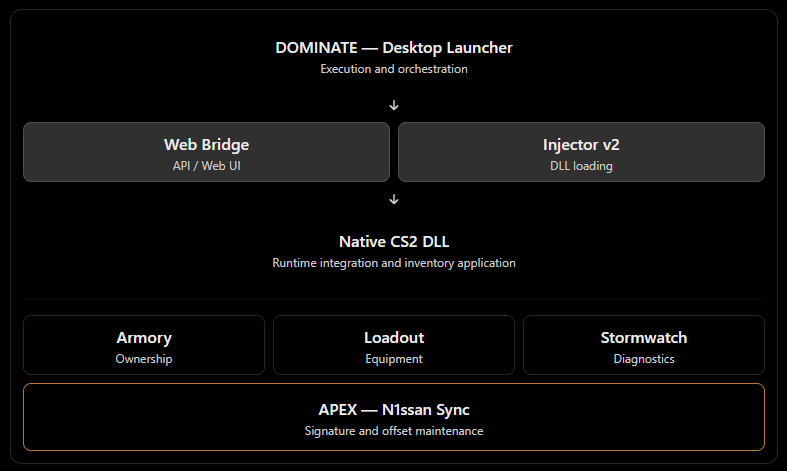

<p align="center">
  
</p>

# n1ssan

[](https://github.com/Cxncer/CS2-N1ssan-Main/releases)


**A modular Counter-Strike 2 inventory system, no copy-paste bs.**

The project is organized around one principle: keep each component's responsibility explicit, keep persisted data safe, and verify runtime behavior instead of treating a successful build as proof.

## Features

- **Armory** — Persistent inventory built around owned item instances, inventory profiles, and separate equipment assignments. Supports weapon skins, stickers, and charms.
- **Loadout** — Catalogue-based equipment selections and saved profiles, kept separate from Armory ownership.
- **DOMINATE** — Windows launcher that coordinates game detection, Bridge startup, web UI, injection, and DLL readiness.
- **Native runtime** — C++ DLL responsible for CS2 integration, inventory projection, item application, and attachment handling.
- **Web Bridge** — Local API and React interfaces connecting the launcher, browser workspaces, and native runtime.
- **Obsidian** — The dark industrial visual system and dedicated Armory experience, with shared design tokens and reusable UI components.
- **Stormwatch diagnostics** — Consolidated runtime, Bridge, and loader health reporting with versioned status records and consistent failure codes.
- **Apex / N1ssan Sync** — Tauri desktop utility for scanning live CS2 signatures, comparing resolved offsets with the shipped dataset, and applying discovered offsets with versioning and backups.

## Components

| Component | Responsibility |
| --- | --- |
| [n1ssan-launcher](https://github.com/Cxncer/n1ssan-launcher) | Windows WPF launcher and application lifecycle |
| [n1ssan-injectorv2](https://github.com/Cxncer/n1ssan-injectorv2) | Standalone native DLL loader |
| [CS2-n1ssan](https://github.com/Cxncer/CS2-n1ssan) | Native C++ runtime for CS2 |
| [n1ssan-web-bridge](https://github.com/Cxncer/n1ssan-web-bridge) | Local Bridge API, Armory, Loadout, and Obsidian web interfaces |
| Apex / N1ssan Sync | Tauri + Rust signature and offset utility in `development/n1ssan-apex` |
| Main workspace | Submodule coordination, contracts, build, release, and project documentation |

## Architecture

<p align="center">
  
</p>

The Bridge owns the application-facing documents and projects compatible runtime data for the DLL. The native runtime applies that data in CS2. The launcher coordinates startup and monitors readiness. Apex is a separate maintenance utility; it scans the running game's module and updates the versioned offset dataset.

## Engineering and safety

- **Ownership is not equipment.** Armory owns item instances; equipment assignments reference those instances. Loadout remains a separate catalogue-selection workflow.
- **Versioned contracts.** Persisted documents and runtime status records have explicit schemas/protocols. Readers reject unsupported newer versions rather than guessing.
- **Data preservation.** Writes use revision checks and backup/recovery paths. Configuration and inventory data live under `%LOCALAPPDATA%\\n1ssan`, outside release packages.
- **Visible runtime health.** Diagnostics distinguish READY, DEGRADED, FAILED, stale, and unknown states. A stale heartbeat is never treated as READY.
- **Controlled offset updates.** Apex scans read-only from the game process; applying results updates the dataset with a version bump and a backup.
- **Reproducible packaging.** The release manifest records component commits, contract versions, and runtime artifact hashes.

## Current development status

**Beta — active development.** The preserved development baseline is `solid-safe-house`.

| Area | Status | Latest recorded work |
| --- | --- | --- |
| DOMINATE / launcher workflow | Implemented | Startup state machine, Bridge and web discovery, injector orchestration, DLL readiness monitoring |
| Armory | Complete | Persistent inventory, owned instances, equipment assignments, stickers and charms; in-game application and the AWP/M4A4 double-charm fix verified on 2026-11-13 |
| Obsidian | Complete | Dedicated Armory experience, shared design tokens, reusable components, rarity presentation |
| Stormwatch | Implemented | Unified diagnostics, protocol 2 status records, signature health, shared failure taxonomy |
| Reforge | Implemented | Documented component contracts, versioning rules, integration snapshot and simulator |
| Atlas | Complete | Standardized workspace, build and release scripts, manifest, contribution and development documentation |
| Apex / N1ssan Sync | In progress | Live `client.dll` signature scanning and versioned offset updates work; remote definition fetching and runtime validation/confidence checks remain |

### Current priorities

1. Complete Apex's definition-fetching workflow using a real, configured source.
2. Validate resolved addresses against live runtime information and report confidence before treating offsets as production-ready.
3. Continue packaged-launch and cross-session validation, including CS2 restarts and T/CT coverage.
4. Continue deferred Armory/Loadout UI consistency work without merging their separate workflows.

The integration simulator checks local document compatibility; it does not replace live in-game acceptance. Likewise, a successful build alone does not prove runtime behavior.

## Build and development

This is a Windows-focused project. The main workspace coordinates the component repositories as Git submodules.

- [Development setup and build instructions](DEVELOPMENT.md)
- [Release and packaging procedure](RELEASE.md)
- [Component contracts](contracts.md)
- [Failure code reference](failure-taxonomy.md)
- [Operation roadmap](operation-roadmap.md)
- [Contribution and branch workflow](CONTRIBUTING.md)

Clone the workspace with its submodules:

```powershell
git clone --recurse-submodules https://github.com/Cxncer/CS2-N1ssan-Main.git
cd CS2-N1ssan-Main
```

Run the complete build-and-check workflow without creating a release package:

```powershell
n1ssan-build.bat verify
```

For prerequisites, component-specific commands, runtime locations, and release packaging, follow the linked documentation rather than mixing build steps from different components.

## Release

The workspace version is maintained in [`VERSION`](VERSION). The current recorded version is **Beta.Build.v1.0.0**.

Release archives follow the format:

```text
n1ssan-<version>-win64.zip
```

Each release includes a staged runtime layout and a manifest containing the component commit set, contract versions, and artifact SHA-256 hashes. See [RELEASE.md](RELEASE.md) for the verification and publishing checklist.

---

**n1ssan — Solid Safe House**

Build. Validate. Ship.
